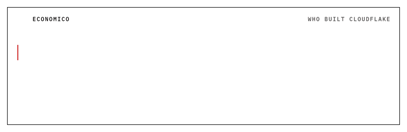

# 

Blofeld explores failures in [Model Context Protocol (MCP)](https://modelcontextprotocol.io) servers autonomously. Point it at an MCP server URL and it discovers the server's tools, resources, and prompts, generates schema-guided valid, boundary, and malformed calls, chains returned IDs across steps, checks protocol and custom invariants, and shrinks any failure down to a minimal replayable trace.

Designed to run the same way you use [Bombadil](https://antithesishq.github.io/bombadil/) for web and terminal UIs—powered by [Hegel](https://hegel.dev) (`hegeltest` / native `libhegel`) for structured generation and shrinking.

We use Blofeld at [Economico](https://economi.co/?utm_source=github&utm_medium=readme&utm_campaign=blofeld) to fuzz and verify our MCP server.

## Try it

Install from [crates.io](https://crates.io/crates/blofeld) and point `blofeld` at any Streamable HTTP MCP server URL:

```sh
cargo install blofeld
blofeld http://localhost:3000/mcp
blofeld --time-limit 5m http://localhost:3000/mcp
```

With authentication (`--token`, `BLOFELD_TOKEN`, or `--token-file` reading either a raw token or JSON `{ "accessToken" | "access_token" | "token" }`), self-signed local HTTPS (`-k`), or read-only safety:

```sh
blofeld https://localhost:8787/mcp -k --token "$TOKEN" --read-only
blofeld https://localhost:8787/mcp -k --token-file .context/auth.json
BLOFELD_TOKEN="$TOKEN" blofeld https://api.example.com/mcp
```

Saved counterexample traces (`--save-trace`) automatically redact `Authorization`, `Cookie`, and API key/token headers so traces are safe to share or commit.

Or test a local stdio MCP server:

```sh
blofeld --stdio node server.js
```

Save and deterministically replay shrunk counterexamples:

```sh
blofeld http://localhost:3000/mcp --save-trace failure.trace.json
blofeld http://localhost:3000/mcp --replay failure.trace.json
```

## Use it with your coding agent

Blofeld ships an [agent skill](skills/blofeld/SKILL.md) that teaches coding agents such as Claude Code, Codex, and Cursor how to fuzz an MCP server, handle authentication cleanly, write YAML invariant rules, and lock in shrunk regressions.

Install it into your project with the [skills](https://skills.sh) CLI:

```sh
npx skills add economico/blofeld
```

Without installing anything, point your agent at [blofeld.dev/skill.md](https://blofeld.dev/skill.md):

> Read https://blofeld.dev/skill.md (or `skills/blofeld/SKILL.md`) and follow it. Start a local isolated instance of our MCP server, obtain a bearer token into a temp auth file, run a Blofeld campaign of at least 15 runs and 40 steps with `--save-trace`, and report any failing property with its shrunk counterexample and replay command.

## What it checks out of the box

With zero configuration, `blofeld` runs MCP discovery (`initialize`, `tools/list`, `resources/list`, `prompts/list`), bootstraps zero-argument read-only tools (such as `businesses` or `list_*`) to seed live IDs, and explores stateful call sequences:

- **Schema-guided generation & shrinking**: generates `Valid`, `Boundary`, and `Malformed` arguments from each tool's JSON Schema (including `format`s like `uuid`/`email`/`uri`/`date-time` and `pattern` regexes), chained via a cross-call `ValuePool` that binds collection IDs and slugs across steps.
- **Protocol & envelope safety**: enforces valid JSON-RPC 2.0 envelopes on 2xx responses, matching IDs, `result` XOR `error`, and valid error objects, while allowing transport-level HTTP 4xx refusals.
- **No crashes / 5xx / hangs**: catches transport drops, EOFs, timeouts, and HTTP 5xx errors.
- **MCP contract conformance**: validates `content` blocks, `outputSchema` conformance on `structuredContent`, and `resources/read` results.
- **Stdout hygiene**: flags stray non-JSON-RPC bytes printed to stdout by stdio servers.
- **No internal stack-trace leaks**: detects raw panics, tracebacks, and segfault signatures across both 2xx and 4xx responses.
- **Dual shrinking**: Hegel shrinks both the action sequence and individual JSON argument payloads simultaneously, followed by symbolic-ID-remapping delta-debugging (`ddmin`) so stateful bugs shrink cleanly even when the server issues fresh UUIDs or sequential IDs.

## Declarative specs & state machines (`--spec` / `--rules`)

Add domain-specific invariants, shadow state machines, active read probes, state-guided action generators, and adversarial fuzzing in YAML—evaluated with a pure-Rust [CEL](https://cel.dev) engine. Every top-level section is optional: start with a couple of simple `rules:` and add state-machine sections only where stateful logic matters.

On every step, Blofeld executes a four-phase loop:
1. **Generate a call** from `actions:` (or general schema/boundary/malformed exploration, plus adversarial attacks when `--adversarial` / `adversarial_rate` is enabled).
2. **Check `rules:`** against the response (latency, substring guards, valid-call guarantees, and CEL `when:`/`assert:` invariants).
3. **Apply `transitions:`** matching the tool to check postconditions and update shadow `state` (or `delete` keys).
4. **Run `probes:`** (read-only verification calls `after: mutating`, `after: every_step`, or specific tool names) to confirm live server state still matches your model.

### 1. Simple stateless rules

Start with zero state machine—just latency budgets, error-leak guards, valid-call guarantees, and CEL response assertions:

```yaml
rules:
  - name: no-sql-errors
    never_contains: "SQLITE_ERROR"
  - name: fast-tools
    max_latency_ms: 2000
  - name: search-always-works
    tool: search
    valid_calls_succeed: true
  - name: positive-invoice-totals
    tool: get_invoice
    when: "ok"
    assert: "res.total >= 0 && has(res.currency)"
```

### 2. Stateful lifecycle model + read probe

Model a resource lifecycle in `state:`, seed initial state in `init:`, update the model in `transitions:`, cross-check real server state with `probes:`, and steer calls with `actions:`:

```yaml
state:
  items: {}
  count: 0

init:
  - name: seed-count
    call: { tool: list_items, arguments: {} }
    update:
      count: "size(res.items)"

transitions:
  - name: item-created
    tool: create_item
    when: "ok"
    assert: "has(res.id) && !(res.id in state.items)"
    update:
      "items[res.id]": "'open'"
      count: "state.count + 1"
  - name: item-locked
    tool: lock_item
    when: "ok"
    update:
      "items[args.id]": "'locked'"
  - name: item-deleted
    tool: delete_item
    when: "ok"
    delete: ["items[args.id]"]
    update:
      count: "state.count - 1"

probes:
  - name: list-matches-model
    after: mutating
    call: { tool: list_items, arguments: {} }
    assert: "ok && size(res.items) == state.count"

actions:
  - tool: lock_item
    when: "'open' in values(state.items)"
    args:
      id: "pick_key_where(state.items, 'open')"
  - tool: delete_item
    when: "size(state.items) > 0"
    args:
      id: "pick_key(state.items)"

rules:
  - name: no-sql-errors
    never_contains: "SQLITE_ERROR"
  - name: fast-tools
    max_latency_ms: 2000
  - name: search-always-works
    tool: search
    valid_calls_succeed: true
  - name: locked-item-cannot-be-deleted
    tool: delete_item
    when: "args.id in state.items && state.items[args.id] == 'locked'"
    assert: "!ok"
```

### 3. Read-only & conservation invariants

Safe to run against staging or production with `--read-only`: discover a tenant and event head during `init:`, then verify after every step that read-only tools never mutate data and financial reports stay balanced:

```yaml
state:
  business: ""
  event_head: 0

init:
  - name: discover-business
    call: { tool: businesses, arguments: {} }
    assert: "ok && size(res.businesses) > 0"
    update:
      business: "res.businesses[0].slug"
  - name: capture-event-head
    call:
      tool: events_list
      arguments: { business: "state.business", limit: 1 }
    assert: "ok"
    update:
      event_head: "size(res.events) > 0 ? res.events[0].seq : 0"

probes:
  - name: reads-never-append-events
    after: every_step
    call:
      tool: events_list
      arguments: { business: "state.business", limit: 1 }
    assert: "ok && (size(res.events) > 0 ? res.events[0].seq : 0) == state.event_head"

rules:
  - name: balance-sheet-balances
    tool: reports_balance_sheet
    when: "ok"
    assert: "res.assets == res.liabilities + res.equity"
```

### 4. Breaking your state machine with adversarial fuzzing

Valid action sequences only test the happy path. Add `adversarial_rate: 0.2` (or pass `--adversarial` / `--adversarial-rate 0.25`) and Blofeld actively tries to break your state machine using three tactics—even when `actions_only: true` is set:

- **Cross-state & precondition breaking**: bypasses `when:` guards and relaxes `pick_key_where` filters (e.g., trying to `ship_order` on an already-cancelled order, or `cancel_order` on a shipped one).
- **Deep nested payload mutations**: mutates inner fields of valid `actions:` payloads—swapping IDs from `state`/`ValuePool`, injecting boundary strings/numbers, flipping JSON types, dropping required keys, or injecting unexpected extra keys.
- **Step replay (verbatim & mutated)**: replays an earlier call (preserving `idempotency_key` to catch duplicate writes, or mutating one field to test idempotency-conflict handling).

```yaml
actions_only: true
adversarial_rate: 0.2

state:
  orders: {}

actions:
  - tool: create_order
    args:
      idempotency_key: "gen_string(8, 16)"
      amount: "gen_int(100, 10000)"
  - tool: cancel_order
    when: "'open' in values(state.orders)"
    args:
      id: "pick_key_where(state.orders, 'open')"
  - tool: ship_order
    when: "'open' in values(state.orders)"
    args:
      id: "pick_key_where(state.orders, 'open')"

transitions:
  - name: order-created
    tool: create_order
    when: "ok"
    update:
      "orders[res.id]": "'open'"
  - name: order-cancelled
    tool: cancel_order
    when: "ok"
    update:
      "orders[args.id]": "'cancelled'"
  - name: order-shipped
    tool: ship_order
    when: "ok"
    update:
      "orders[args.id]": "'shipped'"

rules:
  - name: cannot-ship-cancelled-order
    tool: ship_order
    when: "args.id in state.orders && state.orders[args.id] == 'cancelled'"
    assert: "!ok"
  - name: cannot-cancel-shipped-order
    tool: cancel_order
    when: "args.id in state.orders && state.orders[args.id] == 'shipped'"
    assert: "!ok"
```

```sh
blofeld http://localhost:3000/mcp --spec orders.yaml --adversarial --save-trace failure.trace.json
```

### CEL context & authoring notes

Expressions have access to `state`, `tool`, `args`, `ok`, normalized `res` (`structuredContent` → parsed JSON from `content[0].text` → raw `result`), `text`, `error`, `latency_ms`, `http_status`, and `step` (plus `trigger` in `probes.assert`), helpers (`keys`, `values`, `get`, `set_entry`, `remove_key`, `sum`), and shrinkable Hegel generators inside `actions.args` (`pick_key`, `pick_value`, `pick_key_where`, `pick_item`/`pick`, `gen_int`, `gen_float`, `gen_string`, `gen_bool`). State resets cleanly on every run, during Hegel/`ddmin` shrinking, and during `--replay`.

- String values inside `update:`, `call.arguments:`, and `actions.args:` are evaluated as CEL expressions (while numbers, booleans, and `null` are literal JSON values), so literal strings require inner quotes—e.g. `"'open'"`.
- By default, Blofeld mixes `actions:` with general schema/boundary/malformed exploration; set `actions_only: true` at the top level to restrict generation strictly to `actions:` (and adversarial variants when enabled).

## Hegel & Bombadil-style testing

`blofeld` embeds `hegeltest` (native `libhegel`) in Rust:

- **Locally / in CI**: deterministic seeded exploration (`--seed`), targeted search toward richer harvested state, full Hypothesis + symbolic `ddmin` shrinking, and replayable redacted traces (`--save-trace` / `--replay`).
- **Deterministic simulation ready**: supports external fuzzer entropy (`Backend::Urandom`) and structured property assertions when run inside simulation environments.
- **Self-tested with Hegel**: `cargo test` runs both end-to-end MCP server integration tests and `#[hegel::test]` property tests of `blofeld`'s own generator, validator, SSE parser, envelope checker, and value pool.

## Built by Economico

[](https://economi.co/?utm_source=github&utm_medium=readme&utm_campaign=blofeld)

Blofeld comes out of [Economico](https://economi.co/?utm_source=github&utm_medium=readme&utm_campaign=blofeld), the business context layer for founders and their agents. Your customers, agreements, activity and money live in one structured record your own agents operate, with real books and evidence behind every answer.

## License

Copyright (c) 2026 Economico, LLC. Licensed under the [MIT License](LICENSE).
